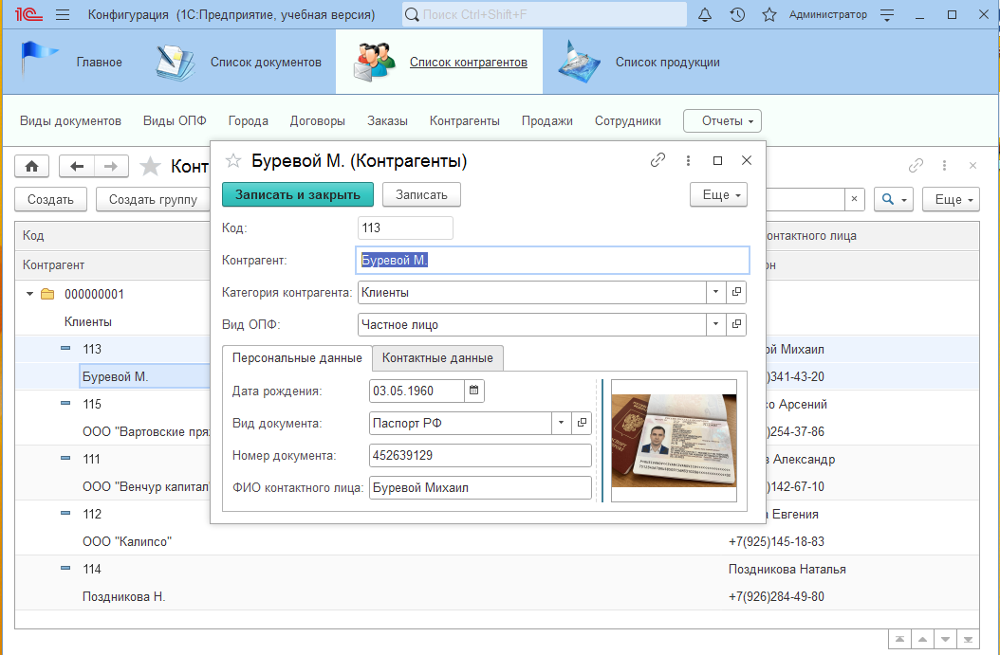
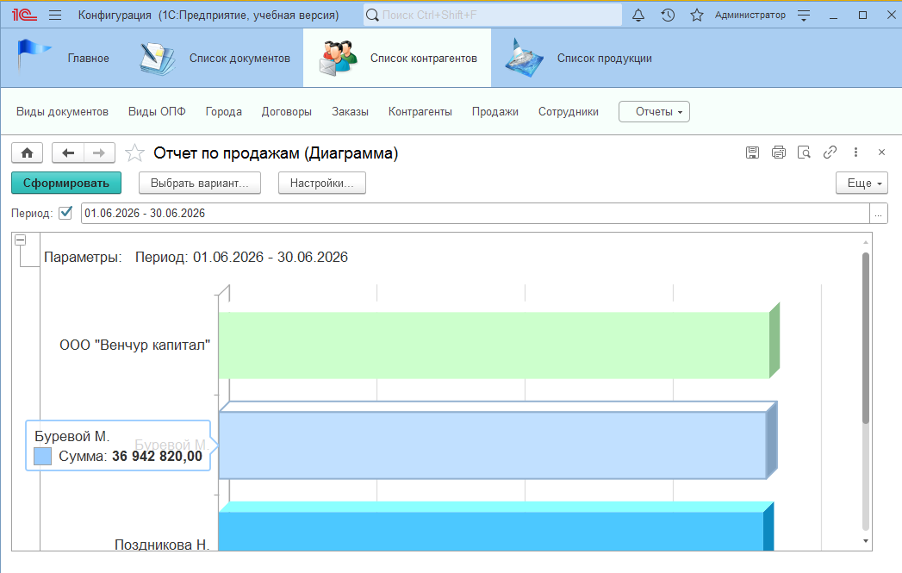
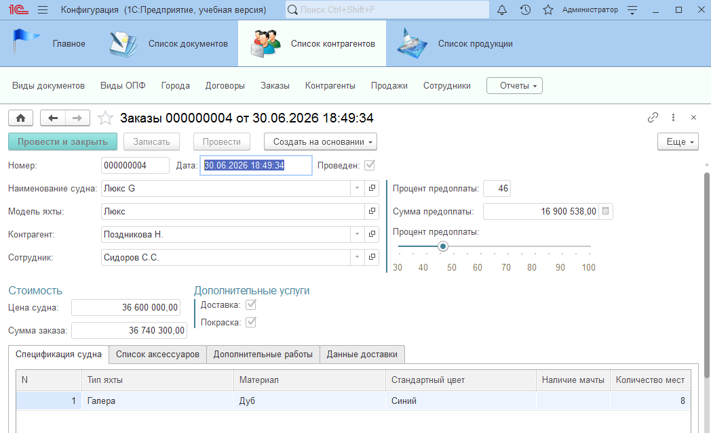
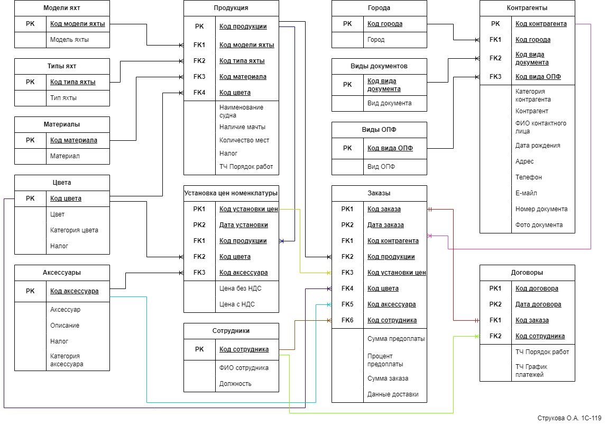

# Информационная система для компании по изготовлению яхт (учебный проект)
Учебный проект, выполненный в рамках курса по разработке на платформе 1С:Предприятие 8.3. Конфигурация создана с нуля и демонстрирует навыки проектирования и разработки: от анализа бизнес-процессов до отчётов и ролей.

# Что реализовано:
- 11 справочников (4 – с индивидуальными формами). В одной из форм реализована загрузка и сохранение изображения. 
- 3 документа: «Установка цен номенклатуры», «Заказ», «Договор». Реализована функция ввода информации в форму документа «Договор» на основании документа «Заказ». Разработаны печатные формы договора купли-продажи, спецификации, дополнительного оборудования, счета на оплату, графика платежей. 
- 2 регистра: «Цены номенклатуры» (регистр сведений), «Продажи» (регистр накопления).
- Отчет «Продажи» с выбором периода и выводом в виде диаграммы и списка (СКД).
- 3 подсистемы, корпоративный стиль.
- 2 роли с разграничением прав: «Администратор» и «Менеджер».
- ER-диаграмма (проектирование базы данных).

# Технологии и механизмы
- Платформа 1С:Предприятие 8.3.
- Конфигурирование: справочники, документы, регистры сведений и накопления.
- Отчеты: СКД, диаграммы\список.
- Работы с двоичными данными (ПоместитьФайл\ИзвлечьФайл).
- Механизм ввода на основании.
- Печатные формы на основе макетов.
- Роли и права доступа.
- Подсистемы и корпоративный стиль.

# Как загрузить проект
1. Скачайте файл выгрузки конфигурации (.dt) из этого репозитория.
2. В 1С:Предприятие создайте новую информационную базу (без конфигурации).
3. Откройте конфигуратор - Администрирование - Загрузить информационную базу.
4. Выберите скачанный .dt-файл и дождитесь загрузки.
5. Запустите 1С:Предприятие в режиме "1С:Предприятие" и проверьте работу объектов.

# Скриншоты
Форма с загрузкой и сохранением изображения

Отчет на СКД в виде диаграммы
 
Форма документа заказ
 
ER-диаграмма

